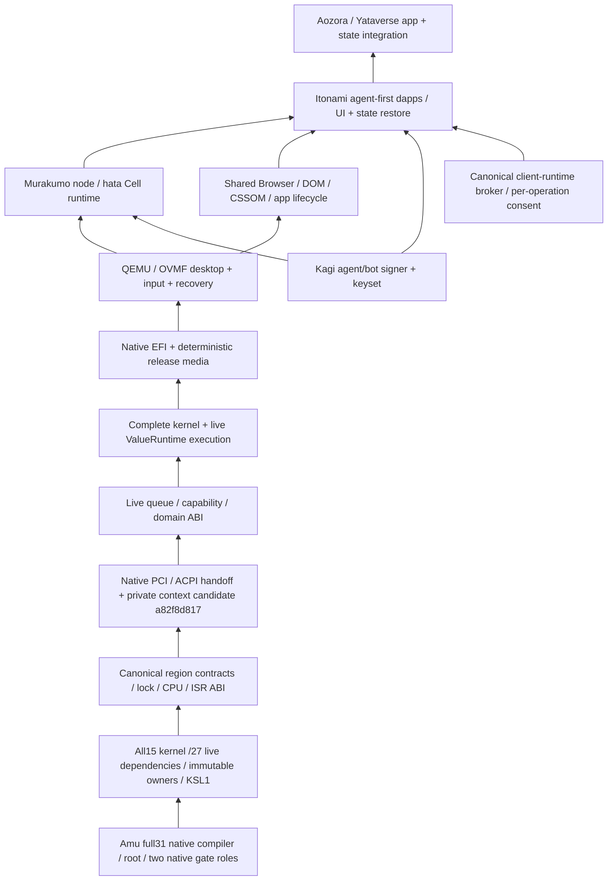

# AIUEOS native integration gates

Owner order,2026-10-24: native compiler adoption, complete kernel dependencies
and locks, region/ISR/live runtime ABI, native media, then QEMU desktop/input.
Shared Browser/CSSOM and Itonami depend on that guest foundation. This is a
source and execution ledger, not an additional maturity score.

The lower box is a prerequisite of the box above it. Murakumo is the execution
host role; Itonami is the agent-first app/workspace role. The Mac's Linux VM
and browser console are separate from an AIUEOS guest.

| Gate | Verified current evidence | Remaining acceptance | Linear |
| --- | --- | --- | --- |
| Legacy CDCI removal | AIUEOS #491 merged8583312; JVM/NBB workflow deleted | Replacement native AIUEOS controller/positive/refusal coverage is absent | JUN-64, AWAI-23 |
| Native compiler adoption | Amu #1547 merged47f41d0b2; final-head CI40082366040 all green; full31 keeps all18 core modules, PR1548 i64 AOT and ADR0373 memory hardening | Main CI40088865343 is a separate gate; broader public hosts/default VM are not qualified | JUN-31 |
| Root/public/controller pins | ARM root fa86314c3f15; actual native x86 F1=F2=F3 equals public9149257032b8; controller/gates rebuild identically; raw receipt self-hashes/provenance read back | Subsequent full37 kernel compiler sources are engineering candidates, with separate adoption still open | JUN-31 |
| Whole graph / source locks | Native discovery covers15 kernel and27 live modules; five immutable external owners; six missing/hash/extra/order/duplicate/digest controls refuse E6015 | All modules must compile and execute together; no declaration/source trimming | JUN-31 |
| Region / lock / interrupt ABI | Full35 ARM self-rebuild; canonical whole-project SIR; CAS/XCR; all32 memory ops; typed64-vector table; QEMU INT3→callback→IRETQ/result42/fuel999999 | Whole-kernel helper/physical/MMIO contracts, error-code IRQ execution and live entry/context ABI | JUN-31 |
| Loader-owned resources | Amu candidates8f23eff8c/b365c83d0 seal15 scratch pages before main; page/window bounds, mutable-header forgery and valid negative controls pass native ARM + QEMU TCG | Successor native x86/controller adoption; whole kernel use remains under validation | JUN-31 |
| Platform resource boundary | Corrected full36 ARM F1=F2 `717f7d15582d`; QEMU private-map forgery / stack exhaustion / shallow negative controls pass | Firmware-type MMIO prototype retired; native PCI/ACPI collector/private consumer now has ARM/QEMU candidate proof; full kernel region contracts and live context/queue/capability/domain ABI remain open | JUN-31 |
| Native media | Native Kotoba transition EFI packaging and bounded corrupt/payload controls are available | Complete kernel image, native GPT/filesystem/release packaging and its receipts; retired hosted/C routes are not fallback | JUN-31, AWAI-23 |
| QEMU desktop/input | Source-bound entry/ISR/memory probes only; firmware GOP metadata read back | Full kernel boot, rendered desktop, input/recovery, logs and screenshot tied to produced media | JUN-31 |
| Browser/CSSOM / Itonami | Owner ports and separate historical measurements exist | Whole native graph, guest lifecycle/render/input, dapp operations/state restore and per-operation broker controls | JUN-93 |

Amu [PR1547](https://github.com/kotoba-lang/amu/pull/1547) was reviewed and merged.
[Final-head CI](https://github.com/kotoba-lang/amu/actions/runs/40082366040)
passed native ARM, native x86, controller24 cases/18 refusals, public aliases,
source-lock controls, browser cases, i64 AOT122 cases/corrupt control and image/EFI
plus27 memory admission cases. Actual retained compiler generations match the
published image. The controller receipt binds the current complete compiler
provenance. Controller and both gate binaries were freshly cross-built to the
same pins; CI retains their receipt pins, rather than those three binaries.
The merged main tree/pins were read back; main CI is not relabelled as complete.

Earlier full30, bounded42 entry and hosted/reference records retain their own
source bindings. A framebuffer descriptor is not a rendered desktop. Native
ARM compilation and QEMU TCG guest execution are also distinct from actual
native x86 execution and the two native CDCI verdict roles.

The successor source linker resolves all real functions/imports into one SIR
ledger and invokes the canonical region checker. Namespace exports are linking
interfaces, not fresh pointer roots. Literal/computed/loaded bases remain
refused. Boot-info v5 is160 bytes plus16KiB map. Scratch constructors use sealed
private image metadata and accept only slots/lengths within the loader's exact
allocation; changing the writable public boot header cannot remint authority.

The AIUEOS source candidate now carries explicit boot region lengths, uses
the shared v5/v6 map offset160 and obtains scratch pages/windows through those constructors.
TX/RX descriptor pages are narrowed explicitly and use4KiB memory instructions.
All-caller private helper extents now retain exact canonical region proof,
including identity-only tail argument writes. Three-module native QEMU helper
fixtures pass with exact result/fuel. The latest full15-module build refuses
E7106 at `debug_link/submit-bus3-frame`, global SIR8339, with no artifact.
The full27 live root stops at missing `kernel-value-provider-queue`.
The retired type11 MMIO
prototype was removed before public adoption: UEFI firmware classifications
cannot grant OS device ownership. See `native-pci-resource-handoff.md` for
the versioned PCI/ACPI handoff candidate, ARM fixed pointdffb92704da8, real
QEMU BAR access/restoration and precise refusal evidence.

The live root has27 modules. Thirteen arena status checks now compare integer
write results explicitly against1; with that source correction the native
frontend identifies missing `kernel-value-provider-queue` (related native
ValueRuntime family: Amu issue625). Queue/capability/domain ABI and the full
live export/context layout remain open. No declaration is removed.
Do not replace either whole graph with a successful probe or restore literal
physical-window roots. JUN-93 remains behind JUN-31 and JUN-90.

## Locked native build protocol

`os/aiueos/scripts/build-kotoba-native-kernel.sh AMU_SOURCE` invokes the native
builder directly. The default compiler is the source tree's pinned public
ELF; an engineering override requires both `AIUEOS_AMU_SELFHOST_BIN` and its
measured `AIUEOS_AMU_SELFHOST_SHA256`. Execute it on matching native Linux
architecture; the public x86 compiler and local ARM candidate are distinct.

The five owner dependencies are pinned by exact source bytes and commit
provenance in `os/aiueos/native/source-dependencies.json`. The builder uses
native module discovery, checks owner pins, writes the complete sorted KSL1
file set with ordered roots, and supplies its digest to both native builds.
It preserves both outputs and compares bytes and immutable input readback.
Use `AIUEOS_NATIVE_KERNEL_SOURCE` to select the full live root and
`AIUEOS_NATIVE_OUT` for a fresh output directory. Failed compilation writes
its named phase and raw diagnostic to `build-state.json`, never a pass.

No source is trimmed and no hosted compiler or packaging fallback is used.
The old nine ValueRuntime/arena files moved byte-identically to their
canonical `kotoba/aiueos/*_*.kotoba` paths so discovery can follow namespaces.
Native image reproduction is still an artifact candidate: all ISR/live
exports, context layout, real execution and refusal controls must pass before
native media, QEMU desktop/input or a replacement AIUEOS CI can be qualified.

## Boundaries to retain

* No Node/NBB/JVM, C compiler, C loader or legacy launcher fallback in the
  accepted compiler/build/execution closure. Python process orchestration
  and format diagnostics do not qualify a native CDCI controller.
* Do not trim the kernel, mirror Browser/CSSOM, or replace a whole component
  with a predicate to make a smaller build pass. Unsupported graphs fail
  closed and stay on the migration ledger.
* Preserve the existing owner CSSOM port and Hermes UEFI worktrees. An
  uncommitted or hosted result cannot be relabelled as merged native proof.
* App origins distribute static artifacts. Use the canonical shared
  `kotoba-client-runtime.js`; keep app state and workflows in the user's
  environment and require fresh consent for each external operation.
* Current signer scope is this Mac's local-software validation only.
  Independent production custody and physical-machine qualification remain
  separate work. This task does not install to a disk or cut over services.
