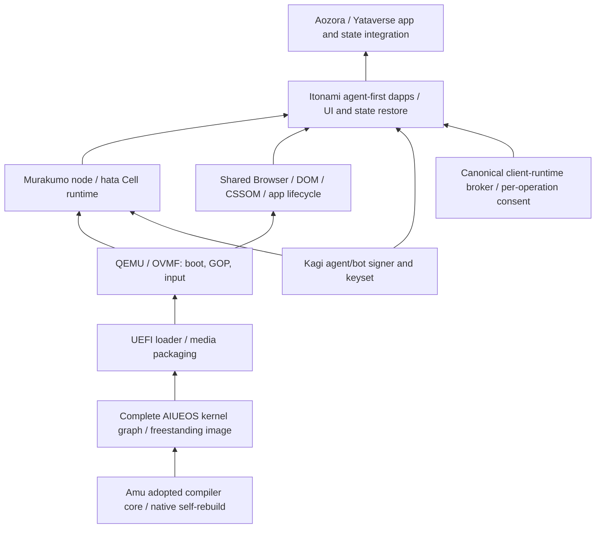

# AIUEOS native integration gates

Owner order, 2026-10-24: remove JVM/nbb CDCI, then Amu selfhost,
kernel/image, QEMU boot, shared Browser/CSSOM and Itonami dapps.
This is a dependency ledger, not an additional maturity score.

The lower box is a prerequisite of the box above it. Murakumo is the
execution host role, Itonami the agent-first app/workspace role. Those roles
do not make the Mac's existing Linux VM or browser console an AIUEOS guest.

| Gate | Current evidence | Required next evidence | Linear |
| --- | --- | --- | --- |
| Legacy CDCI removal | [AIUEOS #491](https://github.com/kotoba-lang/aiueos/pull/491), merged `8583312` deletes the only workflow; AGENTS records missing coverage | A genuine loaderless native controller and positive/refusal gates before restoring CDCI | JUN-64, AWAI-23 |
| Native compiler baseline | PR1547 candidate `bbd09e7cc` retains current main hardening and complete18 core; full30 ARM root `5d537df1` and cross-built public compiler `ba650702` are regenerated; native ARM bootstrap passes | Terminal native x86/controller/public/browser CI and merged-main readback before adoption | JUN-31 |
| Kernel image emitter | Native candidate emits non-live scalar ELF64 images with stack/GDT/TSS/fuel; full30 selfhost reaches F1=F2 and passes unchanged24 native fixtures | All complete-kernel exports, ISR/live runtime, intrinsic ABI and locked transitive source graph; a probe is insufficient | JUN-31 |
| UEFI / media | Canonical Kotoba transition packager generates EFI images; payload boundaries and corrupt ELF refusals checked | Full native adoption and deterministic media with source/artifact receipts; old hosted/C/Python routes remain migration inventory | JUN-31, AWAI-23 |
| QEMU boot | Native-produced EFI/kernel entry probe returns42; return43 is rejected by the check; guest boot-info/fuel/GOP metadata read back | Complete kernel boot, rendered GOP desktop/input, logs and screenshot tied to its receipts | JUN-31 |
| Browser/CSSOM | Owner port and measurements exist; some measurements used owner WIP and Node compiler | Whole shared graph compiled with this native route; render/input parity and restart/crash recovery in the guest | JUN-93 |
| Itonami dapps | Existing app slices and local host services are separate evidence | Actual guest app operations and restored state, signer wiring and broker refusals, then service connections | JUN-93 |

JUN-93 now explicitly depends on JUN-31 as well as its existing scope gate.
Keep all of these issues open until their own acceptance criteria pass.

## Verified entry probe, not complete-kernel acceptance

Amu candidate [PR #1547](https://github.com/kotoba-lang/amu/pull/1547)
(`codex/amu-aiueos-image-20261024`) retains the adopted
core and adds image emission plus ordinary UEFI transition packaging. Its
current full30 compiler rebuilds to identical native ARM F1/F2 `5d537df1`.
The root/public candidate pins are updated and controller/gates regenerate
to their existing bytes. Native x86/current-controller acceptance and merge
remain separate. Earlier `2ebb99ba` receipts predate main's call-site and
base/length hardening and retain their historical source binding.

The generated EFI/kernel pair boots in QEMU/OVMF. QMP observed
`RIP=0x10104b`, `RAX=0x2a`, unchanged sealed fuel1024, boot-info v5 and
GOP metadata1280x800. The kernel is the declared literal42 probe. Those
framebuffer dimensions describe firmware metadata, not a desktop render.
The check also booted a native-produced return43 control and rejected it.

The successor project linker candidate now accepts the actual ordered roots
with KSL1 and its digest. Native discovery and locking cover15 modules for
`native/kernel.kotoba` and27 for `native/value-runtime-kernel.kotoba`.
The latter includes the complete kernel graph and ValueRuntime dependencies.
The TCP retry function needed an explicit scalar result type; its body was
retained. The current full compile refuses the unsupported ISR intrinsic
`kernel-page-fault-handler-address` without emitting an artifact. Do not omit
that declaration or substitute the entry probe for this graph.

The candidate resolves all imported functions into one SIR ledger and invokes
main's canonical region checker over the whole graph. Module exports are
link interfaces, not fresh kernel ABI roots. Its bounded `kernel-boot-info`
constructor names the region the native EFI loader supplies:160-byte v5
prefix plus16KiB map. Checked subregions and all32 memory-width operations
execute in QEMU, while literal/computed/loaded roots and length mismatches
continue to refuse. That constructor grants no arbitrary physical region.

The next integration boundary is pinned transitive source linking plus
complete kernel exports/ISR/live runtime and intrinsic support. Follow
that with native media/full QEMU desktop/input acceptance, then JUN-93.

## Locked native build protocol

`os/aiueos/scripts/build-kotoba-native-kernel.sh AMU_SOURCE` invokes the native
builder directly. The default compiler is the source tree's pinned public
ELF; an engineering override requires both `AIUEOS_AMU_SELFHOST_BIN` and its
measured `AIUEOS_AMU_SELFHOST_SHA256`. Execute it on matching native Linux
architecture; the public x86 compiler and local ARM candidate are distinct.

The five owner dependencies are pinned by exact source bytes and commit
provenance in `os/aiueos/native/source-dependencies.json`. The builder uses
native module discovery, checks owner pins, writes the complete sorted KSL1
file set with ordered roots, and supplies its digest to both native builds.
It preserves both outputs and compares bytes and immutable input readback.
Use `AIUEOS_NATIVE_KERNEL_SOURCE` to select the full live root and
`AIUEOS_NATIVE_OUT` for a fresh output directory. Failed compilation writes
its named phase and raw diagnostic to `build-state.json`, never a pass.

No source is trimmed and no hosted compiler or packaging fallback is used.
The old nine ValueRuntime/arena files moved byte-identically to their
canonical `kotoba/aiueos/*_*.kotoba` paths so discovery can follow namespaces.
Native image reproduction is still an artifact candidate: all ISR/live
exports, context layout, real execution and refusal controls must pass before
native media, QEMU desktop/input or a replacement AIUEOS CI can be qualified.

## Boundaries to retain

* No Node/NBB/JVM, C compiler, C loader or legacy launcher fallback in the
  accepted compiler/build/execution closure. Python process orchestration
  and format diagnostics do not qualify a native CDCI controller.
* Do not trim the kernel, mirror Browser/CSSOM, or replace a whole component
  with a predicate to make a smaller build pass. Unsupported graphs fail
  closed and stay on the migration ledger.
* Preserve the existing owner CSSOM port and Hermes UEFI worktrees. An
  uncommitted or hosted result cannot be relabelled as merged native proof.
* App origins distribute static artifacts. Use the canonical shared
  `kotoba-client-runtime.js`; keep app state and workflows in the user's
  environment and require fresh consent for each external operation.
* Current signer scope is this Mac's local-software validation only.
  Independent production custody and physical-machine qualification remain
  separate work. This task does not install to a disk or cut over services.
