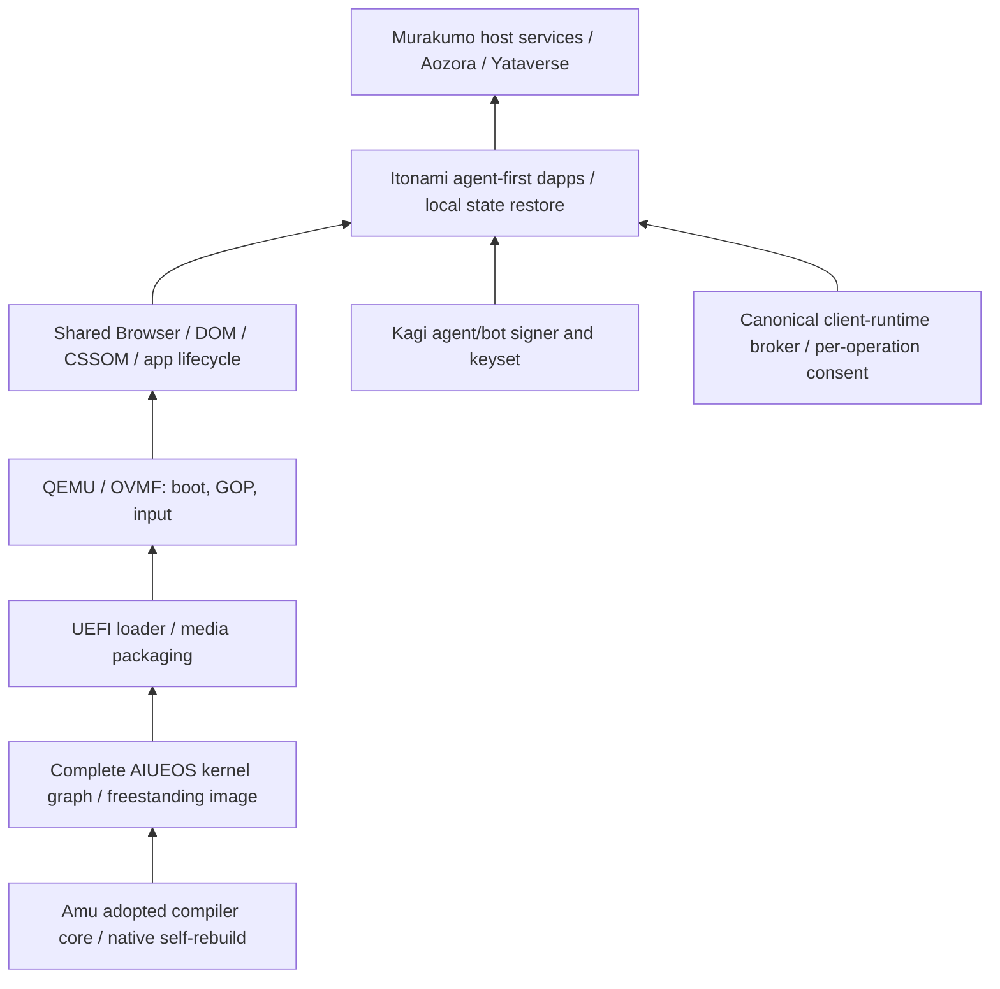

# AIUEOS native integration gates

Owner order, 2026-10-24: remove JVM/nbb CDCI, then Amu selfhost,
kernel/image, QEMU boot, shared Browser/CSSOM and Itonami dapps.
This is a dependency ledger, not an additional maturity score.

The lower box is a prerequisite of the box above it. Murakumo is the
execution host role, Itonami the agent-first app/workspace role. Those roles
do not make the Mac's existing Linux VM or browser console an AIUEOS guest.

| Gate | Current evidence | Required next evidence | Linear |
| --- | --- | --- | --- |
| Legacy CDCI removal | [AIUEOS #491](https://github.com/kotoba-lang/aiueos/pull/491), merged `8583312` deletes the only workflow; AGENTS records missing coverage | A genuine loaderless native controller and positive/refusal gates before restoring CDCI | JUN-64, AWAI-23 |
| Native compiler baseline | Amu `dd35c637`: PR-tier bootstrap reproduces root `688324e0`; 24 native fixtures pass; browser Wasm fixtures compiled only | Rebuild and test the exact successor, preserve adopted core provenance and refresh affected product/gate pins before adoption | JUN-31 |
| Kernel image emitter | Native candidate emits non-live scalar ELF64 images with stack/GDT/TSS/fuel; full30 selfhost reaches F1=F2 and passes unchanged24 native fixtures | All complete-kernel exports, ISR/live runtime, intrinsic ABI and locked transitive source graph; a probe is insufficient | JUN-31 |
| UEFI / media | Canonical Kotoba transition packager generates EFI images; payload boundaries and corrupt ELF refusals checked | Full native adoption and deterministic media with source/artifact receipts; old hosted/C/Python routes remain migration inventory | JUN-31, AWAI-23 |
| QEMU boot | Native-produced EFI/kernel entry probe returns42; return43 is rejected by the check; guest boot-info/fuel/GOP metadata read back | Complete kernel boot, rendered GOP desktop/input, logs and screenshot tied to its receipts | JUN-31 |
| Browser/CSSOM | Owner port and measurements exist; some measurements used owner WIP and Node compiler | Whole shared graph compiled with this native route; render/input parity and restart/crash recovery in the guest | JUN-93 |
| Itonami dapps | Existing app slices and local host services are separate evidence | Actual guest app operations and restored state, signer wiring and broker refusals, then service connections | JUN-93 |

JUN-93 now explicitly depends on JUN-31 as well as its existing scope gate.
Keep all of these issues open until their own acceptance criteria pass.

## Verified entry probe, not complete-kernel acceptance

Amu candidate [PR #1547](https://github.com/kotoba-lang/amu/pull/1547)
(`codex/amu-aiueos-image-20261024`) retains the adopted
core and adds image emission plus ordinary UEFI transition packaging. Its
full30 compiler rebuilds to identical F1/F2 `2ebb99ba0dee2be4`. Image and
EFI artifacts are byte-identical across those generations. No installed
public compiler or root/product/native-controller pin was advanced.

The generated EFI/kernel pair boots in QEMU/OVMF. QMP observed
`RIP=0x10104b`, `RAX=0x2a`, unchanged sealed fuel1024, boot-info v5 and
GOP metadata1280x800. The kernel is the declared literal42 probe. Those
framebuffer dimensions describe firmware metadata, not a desktop render.
The check also booted a native-produced return43 control and rejected it.

The unchanged complete `os/aiueos/native/kernel.kotoba` is still outside
the native command's admitted graph: `--source-path` refuses usage and
`--module-lock` refuses E6015 without emitting an artifact. Do not remove
those declarations, omit dependencies or replace that source with the
probe to obtain a successful build.

The next integration boundary is pinned transitive source linking plus
complete kernel exports/ISR/live runtime and intrinsic support. Follow
that with native media/full QEMU desktop/input acceptance, then JUN-93.

## Boundaries to retain

* No Node/NBB/JVM, C compiler, C loader or legacy launcher fallback in the
  accepted compiler/build/execution closure. Python process orchestration
  and format diagnostics do not qualify a native CDCI controller.
* Do not trim the kernel, mirror Browser/CSSOM, or replace a whole component
  with a predicate to make a smaller build pass. Unsupported graphs fail
  closed and stay on the migration ledger.
* Preserve the existing owner CSSOM port and Hermes UEFI worktrees. An
  uncommitted or hosted result cannot be relabelled as merged native proof.
* App origins distribute static artifacts. Use the canonical shared
  `kotoba-client-runtime.js`; keep app state and workflows in the user's
  environment and require fresh consent for each external operation.
* Current signer scope is this Mac's local-software validation only.
  Independent production custody and physical-machine qualification remain
  separate work. This task does not install to a disk or cut over services.
