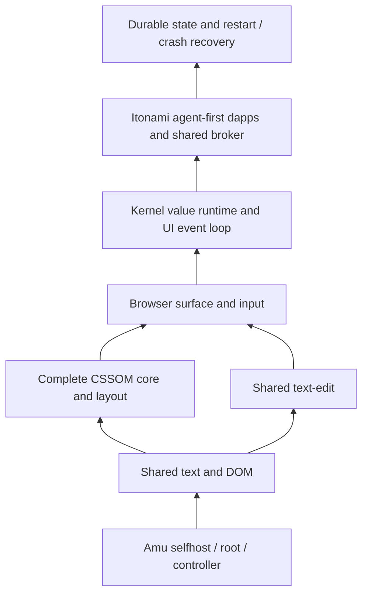

# Shared Browser native integration

JUN-93 proceeds from the compiler and shared components through the complete
kernel UI graph, then Itonami dapps and state restoration. The machine-readable
record is `os/aiueos/qualification/native-shared-browser-20261025.json`.

The source-pinned native component jobs in
[Amu run40151980803](https://github.com/kotoba-lang/amu/actions/runs/40151980803)
execute actual canonical text, DOM and text-edit modules on native ARM and x86
Linux. Their Kotoba verdicts are zero. Text/facade has32 golden assertions,
DOM retains nine native exports, and text-edit retains all13 reducer operations,
including Japanese/emoji caret/selection/delete and IME composition. The x86
project additionally executes multi-hop imports, schemas, callbacks and
library-only keyword output, with six compiler refusal controls. These are
bounded component proofs, not the full hosted parity suite.

The first candidate's actual x86 DOM trap exposed missing keyword-table
linkage. The corrected adapter converts canonical table positions to byte
units and tail-jumps library tables to the final root union. The all47 compiler
retains all18 normal adopted core modules, image and controller/gate identities.
Full compiler/controller/public CI and merge/readback are separately required
by [Amu #1565](https://github.com/kotoba-lang/amu/pull/1565).

Current source-owner work is in [Browser #36](https://github.com/kotoba-lang/browser/pull/36),
[DOM #10](https://github.com/kotoba-lang/dom-gpu/pull/10) and
[Kotoba #838](https://github.com/kotoba-lang/kotoba/pull/838).
The text owner is `kotoba/lib/kotoba.text`; its former repository is archived.
Native qualification must use the canonical owner and immutable source locks.

The retained complete CSSOM candidates still require typed calc AST/pair and
collection contracts. Layout has67 regex occurrences across39 patterns with
capture/split/replace/lookaround semantics that the group-free matcher cannot
silently replace. Native float/document support and every original suite
remain required. These are JUN-134/135/136/137 dependencies, not closed floors.

The native full30 diagnostic desktop is separately reproduced with the final
compiler. Its kernel/EFI/font/media bytes exactly match the QEMU-tested images.
Seven real keyboard/mouse/redraw milestones pass, with private CR3/domain73 and
an unchanged snapshot medium. The receipt explicitly sets BrowserCSSOMParity
and dappsExecuted false: it still uses Browser-frame2 and unregistered cards.
Itonami is the agent-first workspace in this design; a card carrying its name
does not execute its dapps or connect a Murakumo node.

The existing private TCP owner CI also reproduces all seven complete consumer
graphs on native x86 with the final public compiler (`40153896101`, workflow
head `e3a11cfb5e9c951ff48dbeaa9b515a962d3aa192`). Every source blob matches the
immutable AIUEOS and five dependency pins. QEMU passes context 12, typed-call
16, user-entry eight modes, media 11 negative controls and desktop seven input
events. Its desktop kernel/EFI/media match the final ARM-emitted bytes above.
Private source remains in that owner's existing CI context. This regression
does not add shared CSSOM, actual dapp execution or persistent restoration.

The shared kernel value runtime and complete surface/input graph must close
before wiring actual app operations. Use the canonical client-runtime broker
and fresh operation-specific consent. Durable restart/crash restoration must
be tested against real committed state after the dapp path works. Old packed
window-selection values and historical two-record backup tests do not supply
that proof. Hardware/release acceptance and the historical scorecard remain
separate; no product completion percentage is derived from these component jobs.
