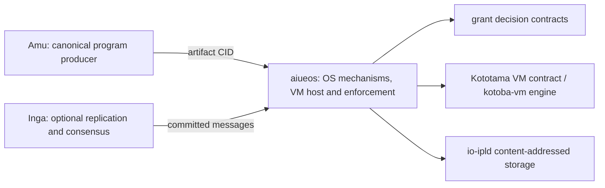

# aiueos: stack integration

Status: accepted architecture direction with partial Kototama host profiles,
2026-10-13. This document and
[composition metadata](../spec/stack-integration.edn) describe ownership and
future boundaries; they do not change runtime schemas or certify migration.

## Responsibility

AiueOS owns boot, memory, process and device mechanisms. It hosts Kototama
programs as one possible OS; it does not define the VM rules. Kototama is the
versioned, engine-neutral VM contract, in the architectural role EVM fills for
Ethereum, without claiming Ethereum bytecode or consensus compatibility. Amu
produces the canonical program, Kotoba VM implements named VM profiles, and
Grant makes permission decisions. Inga is an optional, separate consensus
layer. The portable application format is Kototama; native compiler output is
currently used to boot hardware, while Wasm is explicit legacy compatibility.
The Kototama VM is not yet embedded in the bare-metal image. Existing hybrid,
C-free, QEMU and physical qualification remain separate.

AiueOS's `:kototama/core-i64-subset-v1` and `:kototama/data-i64-v1` values
select hosted value profiles; both implement the normative Kototama `:core/v1`
contract through Kotoba VM. That engine declares `:core/v1` partial. Its
current source candidate contains a bounded positive Datalog evaluator and
five-origin eligibility join, but AiueOS still pins Kotoba VM at
`36cd2472a2d81fbb44db39d9b0e5a6cecf4f53a1`, before that change. The candidate
does not yet supply source-authenticated fact adapters or invocation-time
authorization; actor-state/effect expressions, delegation and receipts also
remain incomplete. These host selectors do not define a competing Kototama
contract.

## Contract dependency direction

Arrows are consumer → contract dependency. These are intended entrypoint
boundaries, not whole-repository imports already achieved.

The runtime dependency declaration includes `grant`, `kotoba-vm` and
`io-ipld`; Inga consensus and its `inga-node` witness process remain in the
optional `:distributed` alias. These are
artifact-admission, VM execution, storage and consensus edges respectively,
not one undifferentiated dependency graph. Alias-only build/test imports remain
separate in the [full observation](https://github.com/kotoba-lang/kotoba-lang/blob/main/lang/stack-dependency-observation.edn).

## Shared architecture and refactor rules

- [Whole stack and distributed flow](https://github.com/kotoba-lang/kotoba-lang/blob/main/docs/stack-architecture-target-neutral.ja.md)
- [Machine-readable architecture direction](https://github.com/kotoba-lang/kotoba-lang/blob/main/lang/stack-architecture-target-neutral.edn)
- [Current measured dependency graph](https://github.com/kotoba-lang/kotoba-lang/blob/main/docs/stack-dependencies-current.md)
- [Coordinated refactor procedure](https://github.com/kotoba-lang/kotoba-lang/blob/main/docs/stack-refactor-procedure.md)
- [Japanese presentation](https://github.com/kotoba-lang/kotoba-lang/blob/main/docs/presentations/kotoba-lisp-machine.ja.md)

Target, host, distribution and consistency are independent selection axes; their
Cartesian product is not a support matrix. Unknown/unqualified profiles fail
closed. Preserve existing wire keys, CID rules and reader compatibility until
a versioned migration. Migrate whole components and public closures; Q9 is
JVM-free. Qualify actual artifacts, denied paths, limits and receipts per
target × host × operation × consistency.

Keep source dependencies, artifact flow, runtime composition and service
relationships separate. No readiness follows for debugger/live editing, heap
image restoration, selfhost, C-free production or physical hardware.
